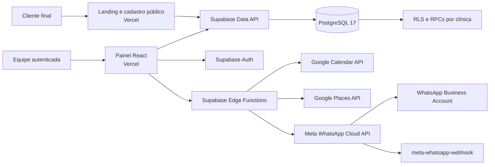

# Arquitetura do Sistema

Atualizado em: 2026-09-12.

## Visão geral

A aplicação de produção é uma SPA React hospedada na Vercel. O navegador usa Supabase Auth e a Data API com uma publishable key; PostgreSQL, RLS, RPCs e Edge Functions formam o backend. Integrações externas ficam nas Edge Functions e nunca recebem secrets pelo bundle Vite.



## Tecnologias e versões

As versões abaixo vêm de `app/package.json` e do projeto remoto; o estado Meta/Supabase foi revisado em 2026-10-08.

| Camada | Tecnologia | Versão/faixa |
| --- | --- | --- |
| Interface | React / React DOM | `19.2.7` |
| Linguagem | TypeScript | `~6.0.2` |
| Build/dev server | Vite | `8.1.1` |
| Rotas | React Router DOM | `7.18.1` |
| Estado assíncrono/cache | TanStack React Query | `5.101.2` |
| Formulários | React Hook Form | `7.80.0` |
| Validação | Zod | `4.4.3` |
| Datas | date-fns | `4.4.0` |
| Ícones | lucide-react | `1.23.0` |
| Cliente backend | `@supabase/supabase-js` | `2.110.0` |
| Lint | Oxlint | `1.71.0` |
| Banco | PostgreSQL | `17.6.1.127` |
| Backend gerenciado | Supabase | Auth, PostgREST, RLS, RPC, Edge Functions, Vault |
| Runtime serverless | Deno/Supabase Edge Runtime | Gerenciado pelo Supabase |
| Hospedagem web | Vercel | SPA estática em `app/dist` |
| Integração agenda | Google Calendar API | OAuth 2.0 + webhooks |
| Avaliações | Google Places API (New) | Edge Function pública |
| Mensagens | Meta WhatsApp Cloud API | Bearer token server-side; templates aprovados e webhook assinado |

O `package-lock.json` deve ser commitado e a Vercel usa `npm ci` para builds reproduzíveis.

## Estrutura do repositório

```text
/
├── app/                         SPA React
│   └── src/                     componentes, contextos, páginas e clientes de integração
├── supabase/                    única fonte de migrations e Edge Functions
├── doc/                         documentação técnica e operacional
├── vercel.json                  comandos de build e rewrite da SPA
└── README.md                    visão rápida do projeto
```

Desde 2026-08-13, não há fontes Supabase duplicadas. `supabase/functions/whatsapp-messages` corresponde à versão simplificada implantada, com fila e processamento periódico. A implementação experimental anterior foi removida para evitar redeploy acidental.

O frontend mantém interesses de serviços em relação normalizada, sem remover o array legado de `clientes`. Campanhas podem usar esse relacionamento para prever e gerar públicos segmentados.

## Frontend

Rotas públicas:

- `/`: landing page, serviços, avaliações do Google e links da clínica;
- `/cadastro-cliente`: cadastro público e interesses em serviços;
- `/login`: login Supabase Auth.

Rotas protegidas:

- `/dashboard`;
- `/clientes`, `/servicos`, `/agenda`, `/agenda/fila-espera`;
- `/equipamentos`, `/planos-tratamento`;
- `/financeiro/fluxo-caixa`, `/financeiro/contas-a-receber`, `/financeiro/contas-a-pagar`;
- `/estoque/itens`, `/estoque/fornecedores`;
- `/mensagens`, `/marketing/campanhas`, `/marketing/disparos`, `/marketing/satisfacao`;
- `/configuracoes/parametros`, `/configuracoes/horarios`, `/configuracoes/usuarios`.

`AuthContext` mantém a sessão. `ClinicContext` carrega perfil, vínculos e clínica ativa. Usuários autenticados sem perfil/vínculo recebem uma tela de bloqueio, não o painel.

## Backend e autorização

O frontend é inicializado somente com:

```text
VITE_SUPABASE_URL
VITE_SUPABASE_PUBLISHABLE_KEY
VITE_APP_ENV
```

A publishable key identifica a aplicação, não o usuário. Depois do login, o JWT pessoal determina o papel Postgres `authenticated`; as policies RLS e `usuarios_clinicas` limitam a clínica e as permissões.

Operações multi-registro usam RPCs transacionais, como salvar agendamento, serviço/preço, campanha/destinatários e confirmar fila de espera. Edge Functions usam secret/service role somente no servidor.

## Fluxos principais

### Login

1. O usuário entra por e-mail/senha no Supabase Auth.
2. A SPA recupera a sessão persistida.
3. Carrega `perfis` e `usuarios_clinicas`.
4. Define a clínica ativa e libera rotas protegidas.
5. Consultas e mutações são filtradas por RLS.

### Cadastro público

1. A página pública consulta serviços liberados pela RPC pública.
2. O cliente informa dados e interesses.
3. A RPC de cadastro cria/atualiza o registro sem expor tabelas administrativas.
4. Consentimento de marketing e WhatsApp não deve nascer pré-marcados.

### Agenda e Google Calendar

1. A SPA salva o agendamento por RPC.
2. Solicita sincronização à `google-calendar-sync`.
3. A função cria/atualiza/cancela o evento Google e grava IDs/estado de sync.
4. Eventos externos do Google tornam-se `bloqueios_agenda`.
5. Webhooks e sync token trazem alterações de volta.

### Planos de tratamento

1. O usuário informa início, horário, quantidade e frequência do plano.
2. A SPA gera ocorrências diária, semanal, mensal ou por intervalo personalizado.
3. Sábado e domingo podem ser habilitados separadamente; datas não permitidas são ajustadas conforme a regra da frequência.
4. A RPC transacional salva o plano, itens e agendamentos, associando o profissional autenticado.
5. Reedições preservam ocorrências passadas, ajustes manuais e itens aguardando reagendamento.

### WhatsApp

1. O cliente precisa ter `whatsapp_opt_in_status='aceito'`.
2. Modelos/regras automáticos usam `canal_padrao='whatsapp_business'`.
3. A Edge Function avalia agendamentos e cria itens idempotentes em `fila_mensagens`.
4. RPC com `FOR UPDATE SKIP LOCKED` reserva lotes.
5. A Meta recebe o template aprovado; o WAMID e os status posteriores vão para fila/logs.
6. O Supabase Cron aciona o processamento a cada cinco minutos usando `pg_net` e Secrets do Vault.

### Disponibilidade comercial semanal

`/configuracoes/horarios` permite que cada profissional configure seus períodos semanais usando `perfis.id` como `profissional_id`. A interface trabalha com intervalos reais, aceita múltiplos períodos por dia e exibe uma sugestão inicial sem persistí-la automaticamente. A gravação completa da semana ocorre pela RPC transacional `salvar_disponibilidade_semanal`, com validação de horários, sobreposição, vínculo à clínica e permissão do usuário.

Dias sem linhas em `disponibilidade_semanal` significam “não atende normalmente”. A disponibilidade não bloqueia a criação manual de atendimentos fora do horário e não altera `bloqueios_agenda` nem a sincronização do Google Calendar. A capacidade comercial canônica é calculada sob demanda pela RPC `calcular_capacidade_comercial_periodo`.

### Exceções de disponibilidade por data

As tabelas `disponibilidade_excecoes` e `disponibilidade_excecao_periodos` registram uma alteração pontual para um profissional e uma data específica. A combinação clínica, profissional e data é única. Uma exceção pode substituir o padrão semanal por novos períodos, inclusive com múltiplos intervalos, ou marcar o dia inteiro como `nao_atende`. Se a exceção for excluída, a data volta a depender apenas do padrão semanal.

A gravação é atômica pelas RPCs `salvar_disponibilidade_excecao` e `excluir_disponibilidade_excecao`, com validação de vínculo, permissão, horários e sobreposição. A exceção substitui totalmente o semanal na data, inclusive quando marca `nao_atende`. Atendimentos manuais continuam permitidos mesmo fora da disponibilidade configurada.

### Capacidade comercial e Radar de ocupação

`calcular_capacidade_comercial_periodo` é a fonte canônica das métricas da agenda. Para cada data local da clínica, aplica a exceção quando existir; caso contrário aplica o semanal. Em seguida subtrai a união dos bloqueios efetivos e mede a união dos atendimentos válidos dentro da capacidade. Bloqueios e atendimentos sobrepostos contam uma vez, interseções parciais são recortadas, atendimentos cancelados não ocupam e atendimentos fora da capacidade não entram no denominador. Capacidade zero retorna ocupação nula, nunca zero.

A RPC usa `clinicas.fuso_horario`, retorna capacidade, ocupação, minutos livres/bloqueados e janelas comerciais livres com início/fim em UTC e horário local. O contrato limita consultas a 63 dias, exige sessão, vínculo à clínica e vínculo do profissional, e não persiste resultado.

`calcular_radar_ocupacao_periodo` consome a capacidade canônica e centraliza a classificação: `SEM_CAPACIDADE`, `AGENDA_COM_OPORTUNIDADES`, `AINDA_HA_DISPONIBILIDADE`, `POUCA_DISPONIBILIDADE`, `BOA_OCUPACAO` ou `QUASE_COMPLETA`. Um dia merece atenção somente quando possui capacidade, tem ocupação abaixo de 65% e ao menos 120 minutos livres. O dashboard consulta exatamente os próximos sete dias a partir de amanhã no fuso da clínica.

### Motor de oportunidades comerciais V1

`calcular_oportunidades_comerciais_periodo` consome o Radar e só avalia dias que merecem atenção. As fontes são a lista de espera ativa (`em_espera`) e retornos de clientes com atendimento concluído, intervalo de retorno definido e data devida vencida ou igual ao dia analisado. Clientes/serviços inativos ou arquivados, históricos cancelados/futuros e retornos já cobertos por agendamento futuro ativo são excluídos.

O motor valida duração integral nas janelas livres e respeita profissional, data, período e intervalo solicitados na lista de espera. Lista de espera vem antes de retorno; dentro de retorno, o maior atraso vem primeiro. A consulta é somente leitura: não usa IA, não gera mensagem, não envia WhatsApp, não agenda, não reserva, não altera a fila e não persiste cache, score ou oportunidade.

### Secretária assistida V1: plano de ação

O Radar continua sendo transitório. A persistência começa somente quando a pessoa clica em `Preparar ação` para um dia específico. Nesse momento o backend reconsulta capacidade, Radar e oportunidades e cria, de forma atômica, um plano `RASCUNHO`, seus itens e a atividade `PLANO_CRIADO`. A seleção é determinística: no máximo cinco candidatos, uma oportunidade por cliente, lista de espera antes de retorno e ordem canônica preservada.

O plano tem snapshot comercial da data, clínica e profissional, além dos estados `RASCUNHO`, `APROVADO` e `CANCELADO`. Os itens podem ficar `SELECIONADO`, `REMOVIDO` ou `INVALIDO`; uma mudança em um cliente não quebra os demais. A secretária revisa em uma folha inferior mobile, remove selecionados e adiciona somente oportunidades atuais do mesmo Radar, sem busca geral de clientes.

Atualizar e aprovar sempre revalidam as RPCs canônicas no servidor. Se capacidade, ocupação, classificação, janelas ou elegibilidade mudarem, o plano volta para revisão explícita; não há aprovação silenciosa. Aprovar é apenas uma decisão interna registrada em `secretaria_atividades`: não contata clientes, não cria agendamento, não reserva horário, não altera a fila e não inicia automação. O Home permanece compacto; a revisão vive na área `Secretária`.
